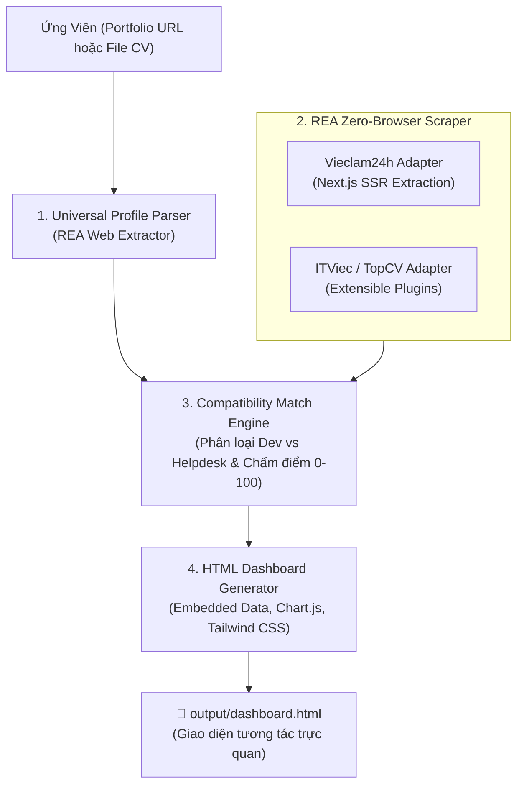

# 🎯 Job Scout VN (job-scout-vn)

> **Personal AI Job Hunter & Reality Checker for Vietnamese Tech Talents**  
> *Trợ lý AI săn việc làm IT & bóc trần sự thật thị trường tuyển dụng tại Việt Nam.*

[](LICENSE)
[](https://nodejs.org/)
[](#t%E1%BA%A1i-sao-ch%E1%BB%8Dn-rea)
[](SKILL.md)
[](https://ko-fi.com/thhoang0903)
[](https://buymeacoffee.com/thhoang0903)
[](https://paypal.me/thieuhoang2209)

---

## 💡 Nỗi Đau Thực Tế Của Lập Trình Viên Việt Nam

Khi tìm kiếm việc làm IT tại Việt Nam trên các trang tuyển dụng lớn:
1. **Bẫy chức danh "IT Phần Mềm":** Hơn **50% - 70%** tin tuyển dụng mang mác "IT Phần mềm" thực chất là tuyển **IT Helpdesk, cài Win, bấm cáp mạng, bảo trì phần cứng hoặc nhân viên tư vấn bán gói phần mềm**. Lập trình viên mất hàng giờ lọc tin trong vô vọng.
2. **Spam từ khóa (Keyword Stuffing):** Các sàn chỉ so sánh từ khóa thô, không hiểu được thực tế ứng viên có những dự án gì, giải quyết được bài toán nào.
3. **Chi phí công cụ đắt đỏ:** Các tool AI quốc tế (Teal, Simplify, Sonara) thu \$20 - \$50/tháng nhưng hoàn toàn tê liệt trước cấu trúc web và ngôn ngữ tiếng Việt tại Việt Nam.

**`job-scout-vn`** ra đời để giải quyết triệt để vấn đề này theo tư duy **Local-First & Agentic AI** (Zero Server Cost, Bảo mật tuyệt đối).

---

## 🌐 Các Nền Tảng Hỗ Trợ & Khả Năng "Soi" Tuyển Dụng Uy Tín

> [!IMPORTANT]
> **Cam kết dữ liệu sạch (No Spam / No Scam):** `job-scout-vn` chủ động **loại bỏ các nền tảng có tiền lệ lộ lọt dữ liệu hoặc tin rác** (như TopCV). Chúng tôi chỉ tập trung vào các sàn tuyển dụng IT uy tín, có kiểm duyệt nghiêm ngặt đối với nhà tuyển dụng.

| Nền tảng | Phân khúc doanh nghiệp | Độ uy tín | Trạng thái kỹ thuật REA |
| :--- | :--- | :---: | :--- |
| **ITViec.com** | Công ty Product, Tech Startups, Offshore chất lượng cao. | ⭐⭐⭐⭐⭐ *(Ít nhưng chất)* | 🔄 **Ưu tiên số 1 v1.1** (Bóc tách internal API JSON) |
| **LinkedIn Jobs** | Tập đoàn đa quốc gia (MNCs), Ngân hàng, Big Tech (Grab, Shopee, VNG, NAB...). | ⭐⭐⭐⭐⭐ *(Lương cao, minh bạch)* | 🔄 **Ưu tiên số 2 v1.1** (Bóc tách Guest Job Search API) |
| **VietnamWorks** | Khối doanh nghiệp FDI, Tập đoàn lớn, Ngân hàng trong nước. | ⭐⭐⭐⭐ *(Kiểm duyệt chặt)* | 📋 **Lộ trình v1.2** (Khai thác Algolia Search API ngầm) |
| **TopDev.vn** | Nền tảng chuyên biệt cho lập trình viên và sự kiện Tech. | ⭐⭐⭐⭐ *(Chuẩn Dev)* | 📋 **Lộ trình v1.2** (Bóc tách REST API) |
| **Vieclam24h.vn** | Doanh nghiệp sản xuất, SME truyền thống (Thích hợp cho Junior/Helpdesk). | ⭐⭐⭐ *(Cần lọc kỹ)* | ✅ **Sẵn sàng 100%** (Giải mã Next.js SSR `__NEXT_DATA__`) |

---

## ✨ Tính Năng Nổi Bật

- ⚡ **Kỹ thuật REA (Reverse Engineering Analysis):** Khai thác trực tiếp Next.js SSR / App Router payloads (`__NEXT_DATA__`, RSC `self.__next_f.push`). Cào hàng trăm việc làm trong **2 giây**, không cần cài đặt Chromium / Puppeteer nặng nề, không tốn RAM.
- 👤 **Bóc tách Hồ sơ Đa nguồn (Universal Profile Ingestion):** Tự động phân tích kỹ năng, số năm kinh nghiệm, các dự án từ **Link Portfolio trực tuyến** (như [thhoang.io.vn](https://thhoang.io.vn)) hoặc **File CV cục bộ** (`.md`, `.txt`, `.json`).
- 🧠 **Ma trận Chấm Điểm Khách Quan (Match Engine):** Tính điểm tương thích $0 - 100\%$ dựa trên chuyên ngành, công nghệ cốt lõi và số năm kinh nghiệm thực tế. Tự động gắn nhãn `DEV MATCH` cho các tin lập trình thực thụ.
- 📊 **Dashboard HTML Độc Lập (Self-Contained):** Xuất ra 1 file HTML duy nhất (Tailwind CSS + Chart.js) mở xem offline mọi lúc, có sẵn biểu đồ phân bổ mức lương, bộ lọc nhanh và link nộp hồ sơ trực tiếp.
- 🤖 **Tương thích Đa nền tảng AI Agent:** Hỗ trợ chuẩn Skill cho **Google Antigravity**, **Claude Code**, và **OpenAI Codex CLI**.

---

## 🏗️ Kiến Trúc Hệ Thống (Architecture)



---

## 🚀 Hướng Dẫn Sử Dụng

### Cách 1: Sử dụng qua dòng lệnh (CLI Mode)

Không cần cài đặt thêm bất kỳ thư viện npm nặng nề nào, chỉ cần máy đã cài Node.js (>= 18):

```bash
# 1. Clone repository
git clone https://github.com/thieuhoang2002/job-scout-vn.git
cd job-scout-vn

# 2. Chạy với link Portfolio trực tuyến
node cli.js --url https://thhoang.io.vn

# 3. Hoặc chạy với file CV mẫu / file cá nhân
node cli.js --cv ./examples/sample_cv.md --pages 4

# 4. Mở file kết quả bằng trình duyệt
# Windows:
start output/dashboard.html
```

#### Các cờ tùy chọn (CLI Flags):
- `--url <url>`: Đường dẫn website Portfolio của bạn.
- `--cv <path>`: Đường dẫn file CV Markdown, Text hoặc JSON.
- `--pages <num>`: Số trang tuyển dụng cần quét (mặc định: `8` trang, ~150 jobs).
- `--output <path>`: Vị trí lưu file HTML xuất ra (mặc định: `./output/dashboard.html`).

---

### Cách 2: Tích hợp làm AI Skill cho Antigravity / Claude Code / Codex

1. Copy toàn bộ thư mục `job-scout-vn` vào thư mục skills của Agent:
   - **Antigravity:** `~/.gemini/antigravity/builtin/skills/job-scout-vn` hoặc `.gemini/config/skills/job-scout-vn`
   - **Claude Code:** `.claude/skills/job-scout-vn`
2. Kích hoạt trực tiếp bằng lệnh:
   ```text
   /job-scout-vn
   ```
   Hoặc ra lệnh tự nhiên trong khung chat:
   > *"Tìm việc làm Fullstack Web phù hợp với portfolio của tôi tại https://thhoang.io.vn"*

---

## 🔌 Giao thức REA: Mở Rộng Adapter Cho Sàn Mới (REA Protocol)

Dự án được thiết kế để cộng đồng dễ dàng đóng góp thêm adapter cho các sàn như **ITViec, TopCV, VietnamWorks, TopDev**:

1. Mở Chrome DevTools (F12) trên trang đích, kiểm tra tab **Network** và mã nguồn HTML ban đầu.
2. Tìm kiếm các State ngầm (`__NEXT_DATA__`, `__NUXT__`, hoặc REST API JSON nội bộ).
3. Tạo file mới trong `src/adapters/<ten_san>.js` tuân theo chuẩn trả về:
   ```javascript
   {
     id, title, company, logo, salary_text, salary_min, salary_max,
     experience, tags, location, url, is_dev, category
   }
   ```
4. Đăng ký adapter vào `src/adapters/index.js`.

---

## 💖 Tài Trợ & Ủng Hộ (Sponsor This Project)

Nếu **Job Scout VN** giúp bạn tìm được công việc ưng ý hoặc tiết kiệm thời gian lọc việc, bạn có thể ủng hộ tách cà phê cho tác giả để duy trì và mở rộng thêm các sàn tuyển dụng mới:

- ☕ **Ko-fi:** [ko-fi.com/thhoang0903](https://ko-fi.com/thhoang0903)
- 🥤 **Buy Me a Coffee:** [buymeacoffee.com/thhoang0903](https://buymeacoffee.com/thhoang0903)
- 💳 **PayPal:** [paypal.me/thieuhoang2209](https://paypal.me/thieuhoang2209)
- 💖 **GitHub Sponsors:** [@thieuhoang2002](https://github.com/sponsors/thieuhoang2002)

---

## 📜 Quy Chuẩn Cộng Đồng (Community Health)

- [Quy tắc ứng xử (Code of Conduct)](CODE_OF_CONDUCT.md)
- [Hướng dẫn đóng góp (Contributing Guide)](CONTRIBUTING.md)
- [Chính sách bảo mật (Security Policy)](SECURITY.md)
- [Giấy phép phần mềm (MIT License)](LICENSE)

---

## 👨‍💻 Tác Giả (Author)

* **Thiều Việt Hoàng (Sky)** — *Software Engineer & Automation Specialist*
* **Portfolio:** [thhoang.io.vn](https://thhoang.io.vn)
* **GitHub:** [@thieuhoang2002](https://github.com/thieuhoang2002)
* **Email:** thhoang0903@gmail.com

⭐ **Hãy để lại 1 Star trên GitHub nếu bạn thấy dự án này hữu ích!**
