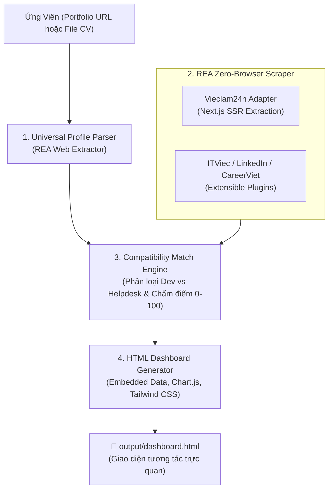

# 🎯 Job Scout VN (job-scout-vn)

> **Personal AI Job Hunter & Reality Checker for Vietnamese Tech Talents**  
> *Trợ lý AI săn việc làm IT & bóc trần sự thật thị trường tuyển dụng tại Việt Nam.*

[](LICENSE)
[](https://nodejs.org/)
[](#-t%E1%BA%A1i-sao-ch%E1%BB%8Dn-rea)
[](SKILL.md)
[](https://ko-fi.com/thhoang0903)
[](https://buymeacoffee.com/thhoang0903)
[](https://paypal.me/thieuhoang2209)

---

## 💡 Nỗi Đau Thực Tế Của Lập Trình Viên Việt Nam

Khi tìm kiếm việc làm IT tại Việt Nam trên các trang tuyển dụng lớn:
1. **Bẫy chức danh "IT Phần Mềm":** Hơn **50% - 70%** tin tuyển dụng mang mác "IT Phần mềm" thực chất là tuyển **IT Helpdesk, cài Win, bấm cáp mạng, bảo trì phần cứng hoặc nhân viên tư vấn bán gói phần mềm**. Lập trình viên mất hàng giờ lọc tin trong vô vọng.
2. **Spam từ khóa & Bán dữ liệu (Keyword Spam & Data Leak):** Các sàn tuyển dụng đại trà thường có tình trạng lộ lọt số điện thoại của ứng viên cho các bên telesale, môi giới, lừa đảo app nạp tiền.
3. **Chi phí công cụ đắt đỏ:** Các tool AI quốc tế (Teal, Simplify, Sonara) thu \$20 - \$50/tháng nhưng hoàn toàn tê liệt trước cấu trúc web và ngôn ngữ tiếng Việt tại Việt Nam.

**`job-scout-vn`** ra đời để giải quyết triệt để vấn đề này theo tư duy **Local-First & Agentic AI** (Zero Server Cost, Bảo mật thông tin tuyệt đối trên máy cá nhân).

---

## 🌐 Các Nền Tảng Hỗ Trợ & Khả Năng "Soi" Tuyển Dụng Uy Tín

> [!IMPORTANT]
> **Cam kết dữ liệu sạch (No Spam / No Scam):** `job-scout-vn` chủ động **loại bỏ các nền tảng có tiền lệ lộ lọt dữ liệu hoặc tin rác** (như TopCV). Chúng tôi chỉ tập trung vào các sàn tuyển dụng IT uy tín, có kiểm duyệt nghiêm ngặt đối với nhà tuyển dụng.

| Nền tảng | Phân khúc doanh nghiệp | Độ uy tín | Trạng thái kỹ thuật REA |
| :--- | :--- | :---: | :--- |
| **ITViec.com** | Công ty Product, Tech Startups, Offshore chất lượng cao. | ⭐⭐⭐⭐⭐ *(Ít nhưng chất)* | 🔄 **Ưu tiên số 1 v1.1** (Bóc tách internal API JSON) |
| **LinkedIn Jobs** | Tập đoàn đa quốc gia (MNCs), Ngân hàng, Big Tech (Grab, Shopee, VNG, NAB...). | ⭐⭐⭐⭐⭐ *(Lương cao, minh bạch)* | 🔄 **Ưu tiên số 2 v1.1** (Bóc tách Guest Job Search API) |
| **CareerViet.vn** *(CareerBuilder)* | Tập đoàn lớn, Doanh nghiệp FDI, Ngân hàng, Chế độ phúc lợi chuẩn chỉ. | ⭐⭐⭐⭐ *(Pháp lý quốc tế)* | 🔄 **Ưu tiên số 3 v1.1** (Bóc tách REST API / Search) |
| **VietnamWorks** | Khối doanh nghiệp FDI, Tập đoàn lớn lâu năm. | ⭐⭐⭐⭐ *(Kiểm duyệt chặt)* | 📋 **Lộ trình v1.2** (Khai thác Algolia Search API ngầm) |
| **TopDev.vn** | Nền tảng chuyên biệt cho lập trình viên và sự kiện Tech. | ⭐⭐⭐⭐ *(Chuẩn Dev)* | 📋 **Lộ trình v1.2** (Bóc tách REST API) |
| **Vieclam24h.vn** | Doanh nghiệp sản xuất, SME truyền thống (Thích hợp cho Junior/Helpdesk). | ⭐⭐⭐ *(Cần lọc kỹ)* | ✅ **Sẵn sàng 100%** (Giải mã Next.js SSR `__NEXT_DATA__`) |

---

## ⚡ Tính Năng Nổi Bật

- 🚀 **Kỹ thuật REA (Reverse Engineering Analysis):** Khai thác trực tiếp Next.js SSR / App Router payloads (`__NEXT_DATA__`, RSC `self.__next_f.push`). Cào hàng trăm việc làm trong **1.5 giây**, không cần cài đặt Chromium / Puppeteer nặng nề, không tốn RAM.
- 👤 **Bóc tách Hồ sơ Đa nguồn (Universal Profile Ingestion):** Tự động phân tích kỹ năng, số năm kinh nghiệm, các dự án từ **Link Portfolio trực tuyến** (như [thhoang.io.vn](https://thhoang.io.vn)) hoặc **File CV cục bộ** (`.md`, `.txt`, `.json`).
- 🧠 **Ma trận Chấm Điểm Khách Quan (Match Engine):** Tính điểm tương thích $0 - 100\%$ dựa trên chuyên ngành, công nghệ cốt lõi và số năm kinh nghiệm thực tế. Tự động gắn nhãn `DEV MATCH` cho các tin lập trình thực thụ.
- 📊 **Dashboard HTML Độc Lập (Self-Contained):** Xuất ra 1 file HTML duy nhất (Tailwind CSS + Chart.js) mở xem offline mọi lúc, có sẵn biểu đồ phân bổ mức lương, bộ lọc nhanh và link nộp hồ sơ trực tiếp.
- 🤖 **Tương thích Đa nền tảng AI Agent:** Hỗ trợ chuẩn Skill cho **Google Antigravity**, **Claude Code**, và **OpenAI Codex CLI**.

---

## 🏗️ Kiến Trúc Hệ Thống (Architecture)



---

## 📖 HƯỚNG DẪN SỬ DỤNG TỪ A ĐẾN Z (AI CŨNG DÙNG ĐƯỢC)

Bạn không cần phải là chuyên gia dòng lệnh, chỉ cần làm theo **3 bước đơn giản** dưới đây:

### ⚡ 3 Bước Bắt Đầu Cực Nhanh (Dành cho người mới)

#### Bước 1: Tải công cụ về máy
Mở Terminal (hoặc PowerShell trên Windows) và gõ:
```bash
git clone https://github.com/thieuhoang2002/job-scout-vn.git
cd job-scout-vn
```

#### Bước 2: Chạy quét việc làm (Chọn 1 trong 2 cách)

* **Cách A — Dùng link Website Portfolio của bạn (Đơn giản nhất):**
  ```bash
  node cli.js --url https://thhoang.io.vn
  ```
  *(Tool sẽ tự động "đọc" website của bạn, nhận diện bạn làm công nghệ gì, có bao nhiêu năm kinh nghiệm và tự động đối chiếu).*

* **Cách B — Dùng file CV có sẵn trên máy:**
  ```bash
  node cli.js --cv ./examples/sample_cv.md --pages 4
  ```
  *(Bạn có thể tạo một file `my_cv.md` hoặc `my_cv.txt` ghi tóm tắt kinh nghiệm của mình rồi truyền vào cờ `--cv`).*

#### Bước 3: Xem Dashboard tương tác trực quan
Sau khi chạy xong (chỉ mất ~2 đến 3 giây), tool sẽ thông báo file kết quả:
* **Trên Windows:**
  ```cmd
  start output\dashboard.html
  ```
* **Trên macOS / Linux:**
  ```bash
  open output/dashboard.html
  ```
Trình duyệt sẽ tự động bật lên Dashboard với đầy đủ biểu đồ, điểm tương thích và link nộp hồ sơ!

---

### 🤖 Cách Dùng Trực Tiếp Trong AI Agent (Antigravity, Claude Code, Codex)

Nếu bạn đang sử dụng các trợ lý lập trình thông minh như **Google Antigravity** hoặc **Claude Code**:

1. Copy toàn bộ thư mục `job-scout-vn` vào thư mục skills:
   - **Antigravity:** `~/.gemini/config/skills/job-scout-vn` (hoặc `~/.gemini/antigravity/builtin/skills/job-scout-vn`)
   - **Claude Code:** `.claude/skills/job-scout-vn`
2. Sử dụng lệnh gõ tắt:
   ```text
   /job-scout-vn
   ```
3. Hoặc chỉ cần chat bằng tiếng Việt tự nhiên:
   > *"Tìm giúp tôi các công việc Fullstack Web ở TP.HCM phù hợp với portfolio https://thhoang.io.vn của tôi"*
   > 
   > AI sẽ tự động kích hoạt Skill, cào dữ liệu mới nhất, phân tích và xuất Dashboard cho bạn ngay trong cuộc trò chuyện!

---

### 🎛️ Bảng Tra Cứu Các Tùy Chọn Lệnh (CLI Reference)

| Cờ lệnh (Flag) | Ý nghĩa | Ví dụ sử dụng |
| :--- | :--- | :--- |
| `--url <link>` | Đường dẫn website Portfolio trực tuyến. | `node cli.js --url https://portfolio-cua-ban.com` |
| `--cv <path>` | Đường dẫn tới file CV cá nhân (`.md`, `.txt`, `.json`). | `node cli.js --cv C:\Users\Admin\Desktop\cv.md` |
| `--pages <num>` | Số trang tuyển dụng muốn quét (Mặc định: 8 trang ~150 jobs). | `node cli.js --url https://thhoang.io.vn --pages 2` |
| `--output <path>`| Nơi bạn muốn lưu file HTML kết quả. | `node cli.js --output ./bao_cao_viec_lam.html` |
| `--help` | Xem danh sách hướng dẫn nhanh. | `node cli.js --help` |

---

### 📊 Cách Đọc & Khai Thác Dashboard Kết Quả Hiệu Quả Nhất

Khi mở file `dashboard.html`, bạn sẽ thấy:
1. **Khung Hồ Sơ Ứng Viên (Trên cùng):** Xem lại AI đã bóc tách đúng những kỹ năng và số năm kinh nghiệm nào từ CV của bạn.
2. **Khu Vực Spotlight (Top Khuyến Nghị):** 5 công việc có điểm tương thích cao nhất ($85\% - 100\%$). Đây là những tin bạn nên bấm nút **"Nộp Hồ Sơ Ngay"** đầu tiên.
3. **Nhãn `DEV MATCH` (Viền xanh):** Chỉ xuất hiện ở các vị trí lập trình phần mềm thực thụ. Hãy bỏ qua các tin không có nhãn này nếu bạn không muốn làm IT Helpdesk hay bấm cáp mạng.
4. **Bộ Lọc Nhanh:** Bấm vào tab `🎯 Đề Xuất Phù Hợp` để lọc ngay các việc có điểm số $\ge 70\%$, hoặc tab `💰 Lương >= 15 Triệu` để xem các vị trí thu nhập tốt.

---

## ❓ Câu Hỏi Thường Gặp (FAQ)

<details>
<summary><strong>1. Tool có lưu trữ hoặc gửi thông tin CV của tôi đi đâu không?</strong></summary>
<p><strong>Tuyệt đối không!</strong> <code>job-scout-vn</code> được xây dựng theo kiến trúc Local-First. Tất cả thao tác bóc tách, chấm điểm và tạo file HTML diễn ra 100% trong bộ nhớ máy tính của bạn. Không có bất kỳ dữ liệu nào bị gửi về máy chủ bên ngoài.</p>
</details>

<details>
<summary><strong>2. Tại sao tool quét 150 việc mà chỉ mất 2 giây? Có bị lỗi không?</strong></summary>
<p>Không hề lỗi. Đó là nhờ <strong>kỹ thuật REA (Reverse Engineering Analysis)</strong>. Tool không mở trình duyệt Chrome ngốn RAM như các công cụ thông thường, mà bóc tách trực tiếp gói dữ liệu SSR ngầm (<code>__NEXT_DATA__</code>) của trang tuyển dụng qua giao thức HTTP thuần, cho tốc độ tức thì.</p>
</details>

<details>
<summary><strong>3. Tôi không có website cá nhân thì có dùng được không?</strong></summary>
<p>Có! Bạn chỉ cần tạo một file <code>my_cv.md</code> hoặc <code>my_cv.txt</code> liệt kê vài dòng về kỹ năng (ví dụ: React, Node.js, C#, SQL, 1 năm kinh nghiệm) rồi chạy lệnh <code>node cli.js --cv my_cv.md</code> là tool sẽ tự động đọc hiểu và phân tích bình thường.</p>
</details>

---

## 🔌 Giao Thức REA: Mở Rộng Adapter Cho Sàn Mới (REA Protocol)

Dự án được thiết kế dạng module mở để cộng đồng có thể dễ dàng bổ sung adapter cho các sàn tuyển dụng:

1. Mở Chrome DevTools (F12) trên trang đích, kiểm tra tab **Network** và mã nguồn HTML ban đầu.
2. Tìm kiếm các State ngầm (`__NEXT_DATA__`, `__NUXT__`, hoặc REST API JSON nội bộ).
3. Tạo file mới trong `src/adapters/<ten_san>.js` tuân theo chuẩn trả về:
   ```javascript
   {
     id, title, company, logo, salary_text, salary_min, salary_max,
     experience, tags, location, url, is_dev, category
   }
   ```
4. Đăng ký adapter vào `src/adapters/index.js`.

---

## 💖 Tài Trợ & Ủng Hộ (Sponsor This Project)

Nếu **Job Scout VN** giúp bạn tìm được công việc ưng ý hoặc tiết kiệm hàng giờ lọc tin rác, bạn có thể ủng hộ tách cà phê cho tác giả để duy trì và mở rộng thêm các sàn tuyển dụng mới:

- ☕ **Ko-fi:** [ko-fi.com/thhoang0903](https://ko-fi.com/thhoang0903)
- 🥤 **Buy Me a Coffee:** [buymeacoffee.com/thhoang0903](https://buymeacoffee.com/thhoang0903)
- 💳 **PayPal:** [paypal.me/thieuhoang2209](https://paypal.me/thieuhoang2209)
- 💖 **GitHub Sponsors:** [@thieuhoang2002](https://github.com/sponsors/thieuhoang2002)

---

## 📜 Quy Chuẩn Cộng Đồng (Community Health)

- [Quy tắc ứng xử (Code of Conduct)](CODE_OF_CONDUCT.md)
- [Hướng dẫn đóng góp (Contributing Guide)](CONTRIBUTING.md)
- [Chính sách bảo mật (Security Policy)](SECURITY.md)
- [Giấy phép phần mềm (MIT License)](LICENSE)

---

## 👨‍💻 Tác Giả (Author)

* **Thiều Việt Hoàng (Sky)** — *Software Engineer & Automation Specialist*
* **Portfolio:** [thhoang.io.vn](https://thhoang.io.vn)
* **GitHub:** [@thieuhoang2002](https://github.com/thieuhoang2002)
* **Email:** thhoang0903@gmail.com

⭐ **Hãy để lại 1 Star trên GitHub nếu bạn thấy dự án này hữu ích!**
