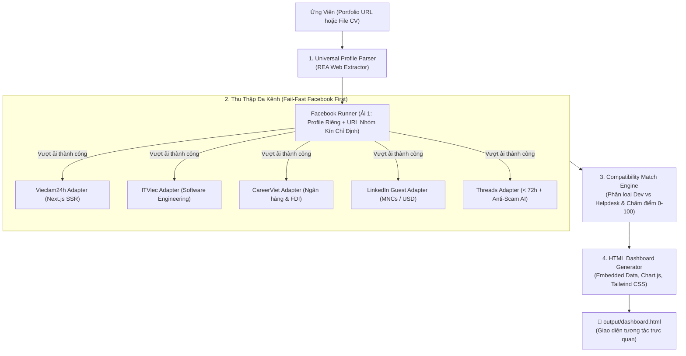

# 🎯 Job Scout VN (job-scout-vn)

> **Personal AI Job Hunter & Reality Checker for Vietnamese Tech Talents**  
> *Trợ lý AI săn việc làm IT & bóc trần sự thật thị trường tuyển dụng tại Việt Nam.*

[](LICENSE)
[](https://nodejs.org/)
[](#-t%E1%BA%A1i-sao-ch%E1%BB%8Dn-rea)
[](SKILL.md)
[](https://ko-fi.com/thhoang0903)
[](https://buymeacoffee.com/thhoang0903)
[](https://paypal.me/thieuhoang2209)

---

## 💡 Nỗi Đau Thực Tế Của Lập Trình Viên Việt Nam

Khi tìm kiếm việc làm IT tại Việt Nam trên các trang tuyển dụng lớn:
1. **Bẫy chức danh "IT Phần Mềm":** Hơn **50% - 70%** tin tuyển dụng mang mác "IT Phần mềm" thực chất là tuyển **IT Helpdesk, cài Win, bấm cáp mạng, bảo trì phần cứng hoặc nhân viên tư vấn bán gói phần mềm**. Lập trình viên mất hàng giờ lọc tin trong vô vọng.
2. **Spam từ khóa & Bán dữ liệu (Keyword Spam & Data Leak):** Các sàn tuyển dụng đại trà thường có tình trạng lộ lọt số điện thoại của ứng viên cho các bên telesale, môi giới, lừa đảo app nạp tiền.
3. **Chi phí công cụ đắt đỏ:** Các tool AI quốc tế (Teal, Simplify, Sonara) thu \$20 - \$50/tháng nhưng hoàn toàn tê liệt trước cấu trúc web và ngôn ngữ tiếng Việt tại Việt Nam.

**`job-scout-vn`** ra đời để giải quyết triệt để vấn đề này theo tư duy **Local-First & Agentic AI** (Zero Server Cost, Bảo mật thông tin tuyệt đối trên máy cá nhân).

---

## 🌐 Các Nền Tảng Tuyển Dụng Đã Tích Hợp Thực Tế

> [!NOTE]
> **Nguyên tắc phát triển trung thực & Phân tầng bảo mật:** 
> - **5 Nền tảng Zero-Login (Mặc định):** Chạy tức thì, 100% không yêu cầu đăng nhập tài khoản cá nhân, không cần mật khẩu.
> - **1 Cổng Facebook Targeted (Chuyên sâu):** Chạy với Chrome Profile độc lập (`~/.job-scout-vn/browser_profile`), người dùng tự đăng nhập an toàn, cơ chế Fail-Fast (chạy đầu tiên).

| Nền tảng | Trạng thái thực tế | Đăng nhập? | Kỹ thuật bóc tách & Lọc thông minh |
| :--- | :---: | :---: | :--- |
| **ITViec.com** | ✅ **Sẵn sàng 100%** | ❌ **Không** | Bóc tách trực tiếp danh sách việc làm Software Dev, Tech Startups, Outsource xịn tại TP.HCM. |
| **LinkedIn Jobs** | ✅ **Sẵn sàng 100%** | ❌ **Không** | Khai thác cổng Guest Job Search API của LinkedIn không cần tài khoản, có Human Jitter chống chặn. |
| **CareerViet.vn** *(CareerBuilder)* | ✅ **Sẵn sàng 100%** | ❌ **Không** | Bóc tách việc làm IT từ khối Ngân hàng, Doanh nghiệp FDI và Tập đoàn lớn. |
| **Vieclam24h.vn** | ✅ **Sẵn sàng 100%** | ❌ **Không** | Khai thác Next.js SSR `__NEXT_DATA__` (Cào hàng trăm việc làm trong 1.5s, không cần trình duyệt). |
| **Threads (threads.net)** | ✅ **Sẵn sàng 100%** | ❌ **Không** | Quét bài đăng tuyển dụng công khai từ mạng lưới Tech Lead & HR công nghệ. **Chỉ nhận bài < 72h** kèm email/telegram liên hệ. |
| **Facebook Groups** | ✅ **Sẵn sàng 100%** | 🔑 **Profile riêng** | Mở trình duyệt chuyên dụng, **bắt buộc chỉ định URL nhóm mục tiêu**, áp dụng Fail-Fast (chạy ải đầu tiên), lọc bài < 72h. |

---

## ⚡ Tính Năng Nổi Bật

- 🚀 **Kỹ thuật REA (Reverse Engineering Analysis):** Khai thác trực tiếp Next.js SSR / App Router payloads (`__NEXT_DATA__`, RSC `self.__next_f.push`). Cào hàng trăm việc làm trong **1.5 giây**, không cần cài đặt Chromium / Puppeteer nặng nề, không tốn RAM.
- 🛡️ **Zero-Login Mặc Định & Dedicated Profile:** 5 sàn chạy tức thì không cần nick. Riêng Facebook chạy trên User Data Profile cách ly hoàn toàn, không đụng chạm tới trình duyệt cá nhân đang dùng hàng ngày.
- 🚪 **Chiến Thuật "Fail-Fast" (Facebook First):** Khi có yêu cầu Facebook, hệ thống sẽ thực thi ải khó này trước tiên. Vượt qua ải Facebook mới cào các sàn khác; nếu không thành công, hệ thống dừng lại ngay lập tức để tiết kiệm tài nguyên.
- ⏱️ **Lọc Thời Gian Vàng (< 72 Giờ):** Tự động loại bỏ mọi bài đăng cũ hơn 3 ngày (> 72h) trên Threads & Facebook để đảm bảo vị trí tuyển dụng còn mở.
- 🚫 **Lá Chắn AI Chống Scam & Bán Khóa Học:** Tự động phát hiện và loại bỏ 100% bài quảng cáo bootcamp lùa gà, nhiệm vụ online, việc nhẹ lương cao, cờ bạc.
- 👤 **Bóc tách Hồ sơ Đa nguồn (Universal Profile Ingestion):** Tự động phân tích kỹ năng, số năm kinh nghiệm, các dự án từ **Link Portfolio trực tuyến** (như `https://myportfolio.dev`) hoặc **File CV cục bộ** (`.md`, `.txt`, `.json`).
- 🧠 **Ma trận Chấm Điểm Khách Quan (Match Engine):** Tính điểm tương thích $0 - 100\%$ dựa trên chuyên ngành, công nghệ cốt lõi và số năm kinh nghiệm thực tế. Tự động gắn nhãn `DEV MATCH` cho các tin lập trình thực thụ.
- 📊 **Dashboard HTML Độc Lập (Self-Contained):** Xuất ra 1 file HTML duy nhất (Tailwind CSS + Chart.js) mở xem offline mọi lúc, có sẵn biểu đồ phân bổ mức lương, bộ lọc nhanh và link nộp hồ sơ trực tiếp.
- 🤖 **Tương thích Đa nền tảng AI Agent:** Hỗ trợ chuẩn Skill cho **Google Antigravity**, **Claude Code**, và **OpenAI Codex CLI**.

---

## 🏗️ Kiến Trúc Hệ Thống (Architecture)



---

## 🚀 Cách Sử Dụng (Dành Cho Người Lười — AI Làm Hết Từ A-Z)

Bạn **không cần phải gõ code phức tạp hay mở terminal**. Hệ thống hỗ trợ bộ mẫu câu lệnh đa hoàn cảnh:

### 🎯 5 Hoàn Cảnh Săn Việc Thực Tế:

#### ⚡ Hoàn cảnh 1: Chế độ Siêu Tốc — 100% Zero-Login (Mặc định)
> Quét tức thì 5 nền tảng mở (ITViec, LinkedIn, CareerViet, ViệcLàm24h, Threads), không cần bất kỳ tài khoản nào.
```text
/job-scout-vn https://myportfolio.dev
```
*Hoặc chat tự nhiên:*
> *"Tìm giúp mình các việc làm IT phù hợp với portfolio https://myportfolio.dev"*

---

#### 📘 Hoàn cảnh 2: Săn Việc Trên Group Facebook Chỉ Định (Fail-Fast & Nhận Diện Profile Thông Minh)
> Quét các hội nhóm công nghệ hoặc group kín đã tham gia. Hỗ trợ tự động nhận diện Profile Chrome qua Email đăng nhập.
```text
/job-scout-vn https://myportfolio.dev --sources facebook,itviec,linkedin --fb-groups "https://facebook.com/groups/nodejsvietnam" --fb-email your_email@gmail.com
```
*Hoặc chat tự nhiên:*
> *"Quét giúp mình các job Node.js trên group https://facebook.com/groups/nodejsvietnam kèm theo các công ty trên ITViec và LinkedIn. Mình đang đăng nhập facebook ở trình duyệt Chrome, profile your_email@gmail.com."*

💡 **Tiện ích nhận diện Profile:** Nếu máy bạn có nhiều Profile Chrome, chỉ cần ghi kèm email (ví dụ: `your_email@gmail.com`), Job Scout VN sẽ tự động đối chiếu và mở đúng Profile đã đăng nhập Facebook sẵn mà bạn không cần phải đăng nhập lại hay tìm thư mục profile thủ công!

---

#### 🌐 Hoàn cảnh 3: Săn Việc Công Ty Đa Quốc Gia & Lương USD (Chỉ ITViec + LinkedIn)
> Tập trung vào doanh nghiệp nước ngoài, môi trường tiếng Anh, mức đãi ngộ cao và làm việc linh hoạt/Remote.
```text
/job-scout-vn https://myportfolio.dev --sources itviec,linkedin
```
*Hoặc chat tự nhiên:*
> *"Đối chiếu portfolio https://myportfolio.dev giúp mình, chỉ tìm việc trên ITViec và LinkedIn, ưu tiên các vị trí Remote hoặc lương trên 25 triệu."*

---

#### 🧵 Hoàn cảnh 4: Săn Tin Tuyển Tuyển Dụng Nóng Hổi Từ Tech Lead Trên Threads (< 72 Giờ)
> Bắt kịp các cơ hội tuyển trực tiếp, phản hồi siêu tốc từ các kỹ sư và trưởng nhóm công nghệ trên Threads.
```text
/job-scout-vn https://myportfolio.dev --sources threads
```
*Hoặc chat tự nhiên:*
> *"Quét giúp mình các bài tuyển dụng React và Node.js mới đăng trong 3 ngày qua trên Threads."*

---

#### 🎓 Hoàn cảnh 5: Dành Cho Junior / Fresher (Lọc Sạch Bẫy Helpdesk / Cài Win)
> Sử dụng file CV cá nhân trên máy (`.md`, `.txt`, `.json`), tập trung vào các vị trí lập trình khởi đầu thực thụ.
```text
/job-scout-vn --cv ./my_cv.md --pages 4
```
*Hoặc chat tự nhiên:*
> *"Mình gửi file CV my_cv.md, hãy tìm các vị trí Junior Lập trình phù hợp, loại bỏ triệt để các tin Helpdesk hay trực vận hành mạng."*

---

### 2. Kết Quả Bạn Sẽ Nhận Được

Một file Dashboard HTML độc lập, mở ngay trên trình duyệt mà không cần cài server:
- 🎯 **Top 5 Việc Làm Khả Thi Nhất (Spotlight):** Vị trí có tỷ lệ đậu cao nhất kèm phân tích lý do cụ thể.
- 🛡️ **Nhãn `DEV MATCH`:** Tự động lọc riêng việc lập trình phần mềm thực thụ, né bẫy Helpdesk / Bán hàng.
- 📈 **Biểu Đồ Thị Trường:** Phân bổ dải lương thực tế và mức độ cạnh tranh theo từng công nghệ.
- ⚡ **1-Click Ứng Tuyển:** Link trực tiếp tới bài đăng tuyển dụng gốc của doanh nghiệp.

---

<details>
<summary><strong>🛠️ Dành cho lập trình viên muốn chạy qua Dòng Lệnh (CLI Mode)</strong></summary>

<br>

Nếu bạn muốn tích hợp vào script tự động hoặc chạy thủ công qua Terminal:

```bash
# 1. Chạy với link website Portfolio (5 sàn Zero-Login)
node cli.js --url https://myportfolio.dev

# 2. Chạy với Facebook Group & nhận diện Profile Chrome qua email
node cli.js --url https://myportfolio.dev --sources facebook,itviec,linkedin --fb-groups "https://facebook.com/groups/nodejsvietnam" --fb-email your_email@gmail.com

# 3. Hoặc chạy với file CV có sẵn trên máy
node cli.js --cv ./examples/sample_cv.md --pages 4

# 4. Mở kết quả trên trình duyệt
start output/dashboard.html
```

**Bảng cờ lệnh (CLI Flags):**
- `--url <link>`: Đường dẫn website Portfolio cá nhân (ví dụ: `https://myportfolio.dev`).
- `--cv <path>`: Đường dẫn file CV Markdown (`.md`), Text (`.txt`), hoặc JSON (`.json`).
- `--sources <list>`: Danh sách nền tảng quét (mặc định: `vieclam24h,itviec,careerviet,linkedin,threads`).
- `--fb-groups <urls>`: Danh sách link Group Facebook mục tiêu.
- `--fb-email <email>`: Email đăng nhập của Profile Chrome cần dùng (ví dụ: `your_email@gmail.com`).
- `--fb-profile <name>`: Tên Profile Chrome (ví dụ: `Default`, `Profile 1`, `Cá nhân`).
- `--pages <num>`: Số trang tuyển dụng cần quét (Mặc định: 6 trang).
- `--output <path>`: Vị trí lưu file HTML (Mặc định: `./output/dashboard.html`).

</details>

---

## ❓ Câu Hỏi Thường Gặp (FAQ)

<details>
<summary><strong>1. Tool có lưu trữ hoặc gửi thông tin CV của tôi đi đâu không?</strong></summary>
<p><strong>Tuyệt đối không!</strong> <code>job-scout-vn</code> được xây dựng theo kiến trúc Local-First. Tất cả thao tác bóc tách, chấm điểm và tạo file HTML diễn ra 100% trong bộ nhớ máy tính của bạn. Không có bất kỳ dữ liệu nào bị gửi về máy chủ bên ngoài.</p>
</details>

<details>
<summary><strong>2. Tại sao tool quét 150 việc mà chỉ mất 2 giây? Có bị lỗi không?</strong></summary>
<p>Không hề lỗi. Đó là nhờ <strong>kỹ thuật REA (Reverse Engineering Analysis)</strong>. Tool không mở trình duyệt Chrome ngốn RAM như các công cụ thông thường, mà bóc tách trực tiếp gói dữ liệu SSR ngầm (<code>__NEXT_DATA__</code>) của trang tuyển dụng qua giao thức HTTP thuần, cho tốc độ tức thì.</p>
</details>

<details>
<summary><strong>3. Tôi không có website cá nhân thì có dùng được không?</strong></summary>
<p>Có! Bạn chỉ cần tạo một file <code>my_cv.md</code> hoặc <code>my_cv.txt</code> liệt kê vài dòng về kỹ năng (ví dụ: React, Node.js, C#, SQL, 1 năm kinh nghiệm) rồi chạy lệnh <code>node cli.js --cv my_cv.md</code> là tool sẽ tự động đọc hiểu và phân tích bình thường.</p>
</details>

<details>
<summary><strong>4. Cơ chế quét Facebook Groups hoạt động thế nào? Có an toàn tài khoản không?</strong></summary>
<p><strong>Cực kỳ an toàn và linh hoạt:</strong> Tool hỗ trợ 2 chế độ:
<br>1. <strong>Tự động nhận diện Profile:</strong> Nếu bạn ghi kèm email (ví dụ: <code>your_email@gmail.com</code>), tool sẽ tự động đọc danh bạ Profile Chrome trên máy và mở đúng Profile đã đăng nhập Facebook sẵn.
<br>2. <strong>Profile độc lập cách ly:</strong> Nếu không chỉ định, tool khởi chạy thư mục riêng biệt (<code>~/.job-scout-vn/browser_profile</code>) để bạn đăng nhập an toàn mà không ảnh hưởng tới bất kỳ dữ liệu duyệt web nào khác.
<br>Tool luôn áp dụng chiến lược <strong>Fail-Fast</strong> (thực thi Facebook đầu tiên, nếu lỗi thì dừng ngay lập tức) và chỉ cuộn nhẹ nhàng mô phỏng người thật trên đúng các Group bạn chỉ định trong Prompt.</p>
</details>

---

## 🔌 Giao Thức REA: Mở Rộng Adapter Cho Sàn Mới (REA Protocol)

Dự án được thiết kế dạng module mở để cộng đồng có thể dễ dàng bổ sung adapter cho các sàn tuyển dụng:

1. Mở Chrome DevTools (F12) trên trang đích, kiểm tra tab **Network** và mã nguồn HTML ban đầu.
2. Tìm kiếm các State ngầm (`__NEXT_DATA__`, `__NUXT__`, hoặc REST API JSON nội bộ).
3. Tạo file mới trong `src/adapters/<ten_san>.js` tuân theo chuẩn trả về:
   ```javascript
   {
     id, title, company, logo, salary_text, salary_min, salary_max,
     experience, tags, location, url, is_dev, category
   }
   ```
4. Đăng ký adapter vào `src/adapters/index.js`.

---

## 💖 Tài Trợ & Ủng Hộ (Sponsor This Project)

Nếu **Job Scout VN** giúp bạn tìm được công việc ưng ý hoặc tiết kiệm hàng giờ lọc tin rác, bạn có thể ủng hộ tách cà phê cho tác giả để duy trì và mở rộng thêm các sàn tuyển dụng mới:

- ☕ **Ko-fi:** [ko-fi.com/thhoang0903](https://ko-fi.com/thhoang0903)
- 🥤 **Buy Me a Coffee:** [buymeacoffee.com/thhoang0903](https://buymeacoffee.com/thhoang0903)
- 💳 **PayPal:** [paypal.me/thieuhoang2209](https://paypal.me/thieuhoang2209)
- 💖 **GitHub Sponsors:** [@thieuhoang2002](https://github.com/sponsors/thieuhoang2002)

---

## 📜 Quy Chuẩn Cộng Đồng (Community Health)

- [Quy tắc ứng xử (Code of Conduct)](CODE_OF_CONDUCT.md)
- [Hướng dẫn đóng góp (Contributing Guide)](CONTRIBUTING.md)
- [Chính sách bảo mật (Security Policy)](SECURITY.md)
- [Giấy phép phần mềm (MIT License)](LICENSE)

---

## 👨‍💻 Tác Giả (Author)

* **Thiều Việt Hoàng (Sky)** — *Software Engineer & Automation Specialist*
* **Portfolio:** [thhoang.io.vn](https://thhoang.io.vn)
* **GitHub:** [@thieuhoang2002](https://github.com/thieuhoang2002)
* **Email:** contact@thhoang.io.vn

⭐ **Hãy để lại 1 Star trên GitHub nếu bạn thấy dự án này hữu ích!**
