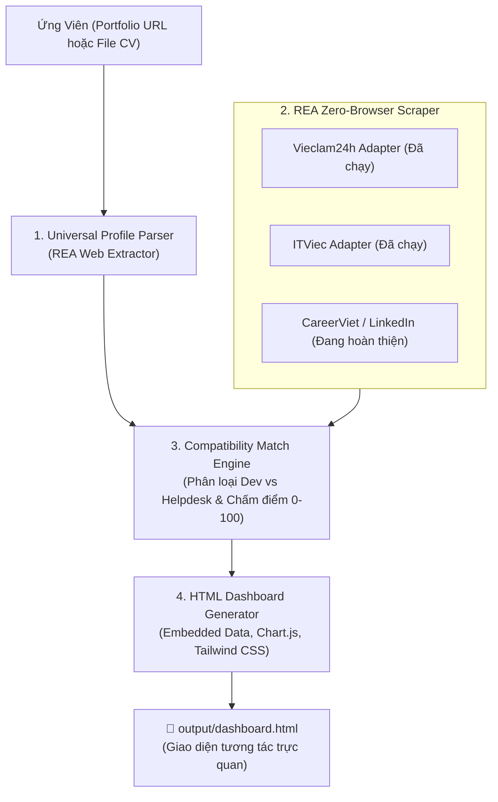

# 🎯 Job Scout VN (job-scout-vn)

> **Personal AI Job Hunter & Reality Checker for Vietnamese Tech Talents**  
> *Trợ lý AI săn việc làm IT & bóc trần sự thật thị trường tuyển dụng tại Việt Nam.*

[](LICENSE)
[](https://nodejs.org/)
[](#-t%E1%BA%A1i-sao-ch%E1%BB%8Dn-rea)
[](SKILL.md)
[](https://ko-fi.com/thhoang0903)
[](https://buymeacoffee.com/thhoang0903)
[](https://paypal.me/thieuhoang2209)

---

## 💡 Nỗi Đau Thực Tế Của Lập Trình Viên Việt Nam

Khi tìm kiếm việc làm IT tại Việt Nam trên các trang tuyển dụng lớn:
1. **Bẫy chức danh "IT Phần Mềm":** Hơn **50% - 70%** tin tuyển dụng mang mác "IT Phần mềm" thực chất là tuyển **IT Helpdesk, cài Win, bấm cáp mạng, bảo trì phần cứng hoặc nhân viên tư vấn bán gói phần mềm**. Lập trình viên mất hàng giờ lọc tin trong vô vọng.
2. **Spam từ khóa & Bán dữ liệu (Keyword Spam & Data Leak):** Các sàn tuyển dụng đại trà thường có tình trạng lộ lọt số điện thoại của ứng viên cho các bên telesale, môi giới, lừa đảo app nạp tiền.
3. **Chi phí công cụ đắt đỏ:** Các tool AI quốc tế (Teal, Simplify, Sonara) thu \$20 - \$50/tháng nhưng hoàn toàn tê liệt trước cấu trúc web và ngôn ngữ tiếng Việt tại Việt Nam.

**`job-scout-vn`** ra đời để giải quyết triệt để vấn đề này theo tư duy **Local-First & Agentic AI** (Zero Server Cost, Bảo mật thông tin tuyệt đối trên máy cá nhân).

---

## 🌐 Các Nền Tảng Tuyển Dụng Đã Tích Hợp Thực Tế

> [!NOTE]
> **Nguyên tắc phát triển trung thực:** Chúng tôi chỉ hiển thị những nền tảng đã được viết code hoàn chỉnh và chạy thực tế. Không quảng cáo những sàn chưa hoàn thiện.

| Nền tảng | Trạng thái thực tế | Kỹ thuật bóc tách REA |
| :--- | :---: | :--- |
| **ITViec.com** | ✅ **Sẵn sàng 100%** | Bóc tách trực tiếp danh sách việc làm Software Dev, Tech Startups, Outsource xịn tại TP.HCM. |
| **Vieclam24h.vn** | ✅ **Sẵn sàng 100%** | Khai thác Next.js SSR `__NEXT_DATA__` (Cào hàng trăm việc làm trong 1.5s, không cần trình duyệt). |
| **CareerViet.vn** *(CareerBuilder)* | 🔄 *Đang viết Adapter* | Khai thác endpoint tìm kiếm việc làm doanh nghiệp FDI & Ngân hàng. |
| **LinkedIn Jobs** | 🔄 *Đang viết Adapter* | Khai thác Guest Search API không cần đăng nhập. |

---

## ⚡ Tính Năng Nổi Bật

- 🚀 **Kỹ thuật REA (Reverse Engineering Analysis):** Khai thác trực tiếp Next.js SSR / App Router payloads (`__NEXT_DATA__`, RSC `self.__next_f.push`). Cào hàng trăm việc làm trong **1.5 giây**, không cần cài đặt Chromium / Puppeteer nặng nề, không tốn RAM.
- 👤 **Bóc tách Hồ sơ Đa nguồn (Universal Profile Ingestion):** Tự động phân tích kỹ năng, số năm kinh nghiệm, các dự án từ **Link Portfolio trực tuyến** (như [thhoang.io.vn](https://thhoang.io.vn)) hoặc **File CV cục bộ** (`.md`, `.txt`, `.json`).
- 🧠 **Ma trận Chấm Điểm Khách Quan (Match Engine):** Tính điểm tương thích $0 - 100\%$ dựa trên chuyên ngành, công nghệ cốt lõi và số năm kinh nghiệm thực tế. Tự động gắn nhãn `DEV MATCH` cho các tin lập trình thực thụ.
- 📊 **Dashboard HTML Độc Lập (Self-Contained):** Xuất ra 1 file HTML duy nhất (Tailwind CSS + Chart.js) mở xem offline mọi lúc, có sẵn biểu đồ phân bổ mức lương, bộ lọc nhanh và link nộp hồ sơ trực tiếp.
- 🤖 **Tương thích Đa nền tảng AI Agent:** Hỗ trợ chuẩn Skill cho **Google Antigravity**, **Claude Code**, và **OpenAI Codex CLI**.

---

## 🏗️ Kiến Trúc Hệ Thống (Architecture)



---

## 🚀 Cách Sử Dụng (Dành Cho Người Lười — AI Làm Hết Từ A-Z)

Bạn **không cần phải gõ code phức tạp hay mở terminal**. Hãy để AI Agent làm toàn bộ công việc tìm kiếm và lọc việc:

### 1. Kích hoạt trực tiếp bằng 1 câu lệnh trong AI Chat
Nếu bạn đang dùng **Google Antigravity**, **Claude Code**, hoặc **Codex**, chỉ cần gõ:
```text
/job-scout-vn
```
Hoặc chat tự nhiên bằng tiếng Việt:
> *"Tìm giúp mình các việc làm IT phù hợp với portfolio https://thhoang.io.vn"*

✨ **AI sẽ tự động:**
1. Quét portfolio / CV của bạn để rút ra kỹ năng và số năm kinh nghiệm.
2. Cào tức thì hàng trăm tin tuyển dụng từ các sàn uy tín.
3. Chấm điểm độ tương thích ($0 - 100\%$) và lọc sạch tin Helpdesk / Cài Win.
4. Bật sẵn **Dashboard HTML tương tác** cho bạn chỉ việc click nộp hồ sơ!

---

### 2. Kết Quả Bạn Sẽ Nhận Được

Một file Dashboard HTML độc lập, mở ngay trên trình duyệt mà không cần cài server:
- 🎯 **Top 5 Việc Làm Khả Thi Nhất (Spotlight):** Vị trí có tỷ lệ đậu cao nhất kèm phân tích lý do cụ thể.
- 🛡️ **Nhãn `DEV MATCH`:** Tự động lọc riêng việc lập trình phần mềm thực thụ, né bẫy Helpdesk / Bán hàng.
- 📈 **Biểu Đồ Thị Trường:** Phân bổ dải lương thực tế và mức độ cạnh tranh theo từng công nghệ.
- ⚡ **1-Click Ứng Tuyển:** Link trực tiếp tới bài đăng tuyển dụng gốc của doanh nghiệp.

---

<details>
<summary><strong>🛠️ Dành cho lập trình viên muốn chạy qua Dòng Lệnh (CLI Mode)</strong></summary>

<br>

Nếu bạn muốn tích hợp vào script tự động hoặc chạy thủ công qua Terminal:

```bash
# 1. Chạy với link website Portfolio
node cli.js --url https://thhoang.io.vn

# 2. Hoặc chạy với file CV có sẵn trên máy
node cli.js --cv ./examples/sample_cv.md --pages 4

# 3. Mở kết quả trên trình duyệt
start output/dashboard.html
```

**Bảng cờ lệnh (CLI Flags):**
- `--url <link>`: Đường dẫn website Portfolio cá nhân.
- `--cv <path>`: Đường dẫn file CV Markdown (`.md`), Text (`.txt`), hoặc JSON (`.json`).
- `--pages <num>`: Số trang tuyển dụng cần quét (Mặc định: 8 trang ~150 jobs).
- `--output <path>`: Vị trí lưu file HTML (Mặc định: `./output/dashboard.html`).

</details>

---

## ❓ Câu Hỏi Thường Gặp (FAQ)

<details>
<summary><strong>1. Tool có lưu trữ hoặc gửi thông tin CV của tôi đi đâu không?</strong></summary>
<p><strong>Tuyệt đối không!</strong> <code>job-scout-vn</code> được xây dựng theo kiến trúc Local-First. Tất cả thao tác bóc tách, chấm điểm và tạo file HTML diễn ra 100% trong bộ nhớ máy tính của bạn. Không có bất kỳ dữ liệu nào bị gửi về máy chủ bên ngoài.</p>
</details>

<details>
<summary><strong>2. Tại sao tool quét 150 việc mà chỉ mất 2 giây? Có bị lỗi không?</strong></summary>
<p>Không hề lỗi. Đó là nhờ <strong>kỹ thuật REA (Reverse Engineering Analysis)</strong>. Tool không mở trình duyệt Chrome ngốn RAM như các công cụ thông thường, mà bóc tách trực tiếp gói dữ liệu SSR ngầm (<code>__NEXT_DATA__</code>) của trang tuyển dụng qua giao thức HTTP thuần, cho tốc độ tức thì.</p>
</details>

<details>
<summary><strong>3. Tôi không có website cá nhân thì có dùng được không?</strong></summary>
<p>Có! Bạn chỉ cần tạo một file <code>my_cv.md</code> hoặc <code>my_cv.txt</code> liệt kê vài dòng về kỹ năng (ví dụ: React, Node.js, C#, SQL, 1 năm kinh nghiệm) rồi chạy lệnh <code>node cli.js --cv my_cv.md</code> là tool sẽ tự động đọc hiểu và phân tích bình thường.</p>
</details>

---

## 🔌 Giao Thức REA: Mở Rộng Adapter Cho Sàn Mới (REA Protocol)

Dự án được thiết kế dạng module mở để cộng đồng có thể dễ dàng bổ sung adapter cho các sàn tuyển dụng:

1. Mở Chrome DevTools (F12) trên trang đích, kiểm tra tab **Network** và mã nguồn HTML ban đầu.
2. Tìm kiếm các State ngầm (`__NEXT_DATA__`, `__NUXT__`, hoặc REST API JSON nội bộ).
3. Tạo file mới trong `src/adapters/<ten_san>.js` tuân theo chuẩn trả về:
   ```javascript
   {
     id, title, company, logo, salary_text, salary_min, salary_max,
     experience, tags, location, url, is_dev, category
   }
   ```
4. Đăng ký adapter vào `src/adapters/index.js`.

---

## 💖 Tài Trợ & Ủng Hộ (Sponsor This Project)

Nếu **Job Scout VN** giúp bạn tìm được công việc ưng ý hoặc tiết kiệm hàng giờ lọc tin rác, bạn có thể ủng hộ tách cà phê cho tác giả để duy trì và mở rộng thêm các sàn tuyển dụng mới:

- ☕ **Ko-fi:** [ko-fi.com/thhoang0903](https://ko-fi.com/thhoang0903)
- 🥤 **Buy Me a Coffee:** [buymeacoffee.com/thhoang0903](https://buymeacoffee.com/thhoang0903)
- 💳 **PayPal:** [paypal.me/thieuhoang2209](https://paypal.me/thieuhoang2209)
- 💖 **GitHub Sponsors:** [@thieuhoang2002](https://github.com/sponsors/thieuhoang2002)

---

## 📜 Quy Chuẩn Cộng Đồng (Community Health)

- [Quy tắc ứng xử (Code of Conduct)](CODE_OF_CONDUCT.md)
- [Hướng dẫn đóng góp (Contributing Guide)](CONTRIBUTING.md)
- [Chính sách bảo mật (Security Policy)](SECURITY.md)
- [Giấy phép phần mềm (MIT License)](LICENSE)

---

## 👨‍💻 Tác Giả (Author)

* **Thiều Việt Hoàng (Sky)** — *Software Engineer & Automation Specialist*
* **Portfolio:** [thhoang.io.vn](https://thhoang.io.vn)
* **GitHub:** [@thieuhoang2002](https://github.com/thieuhoang2002)
* **Email:** contact@thhoang.io.vn

⭐ **Hãy để lại 1 Star trên GitHub nếu bạn thấy dự án này hữu ích!**
